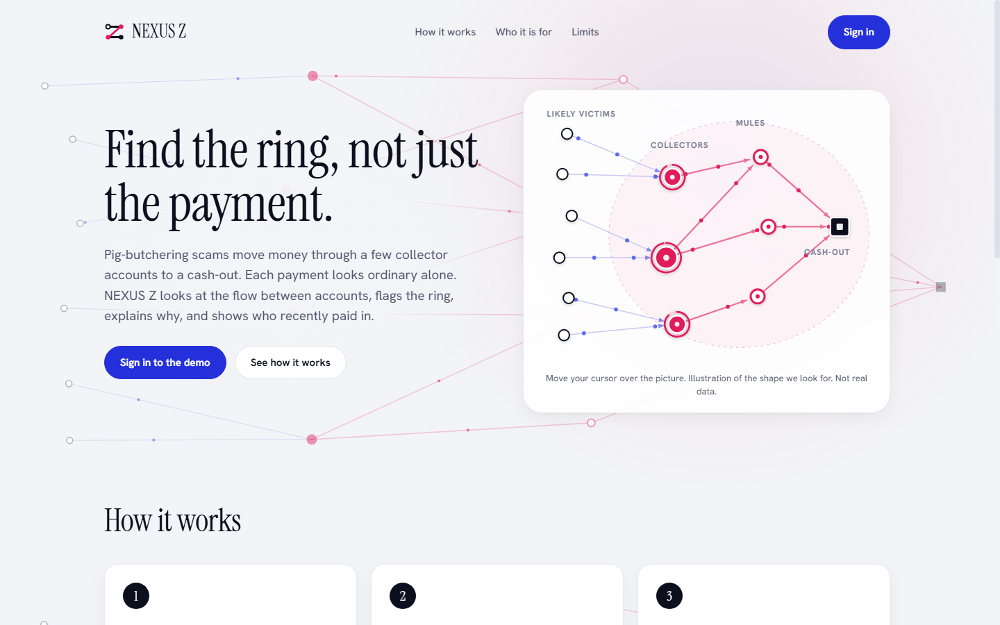
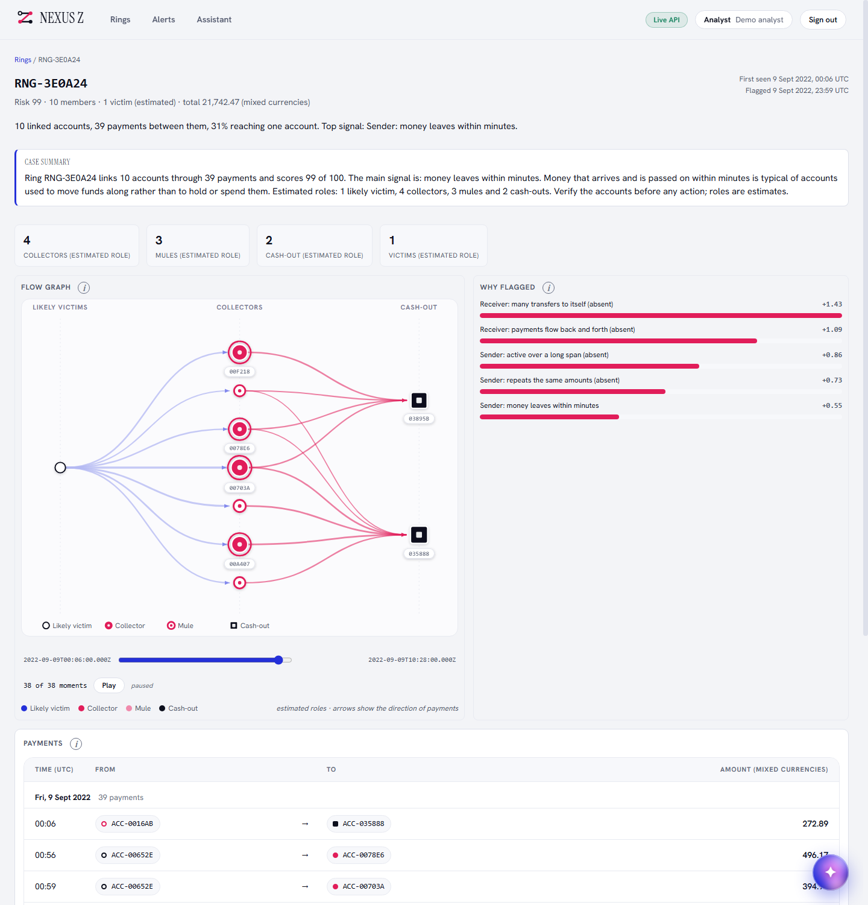
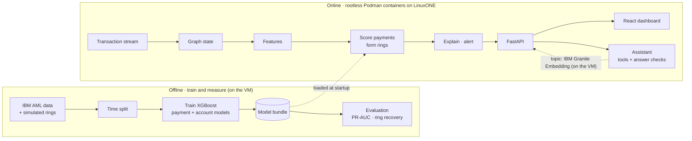
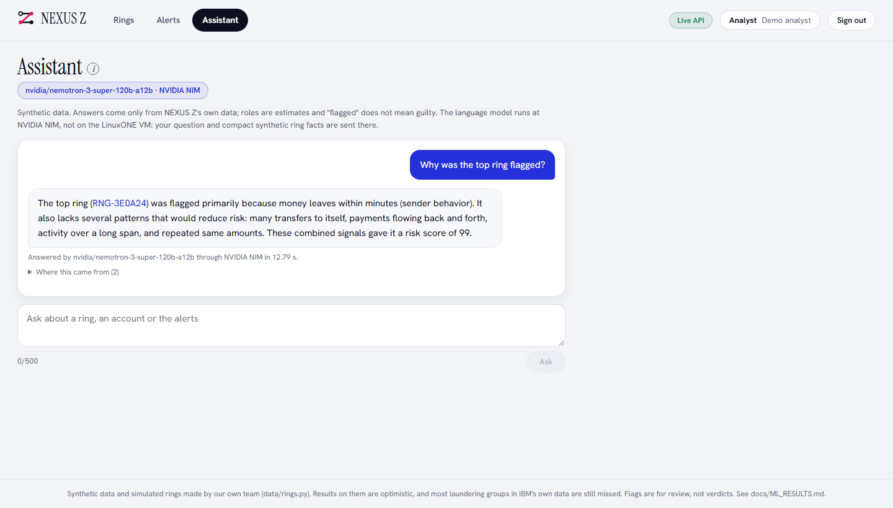

<div align="center">

# NEXUS&nbsp;Z

### Find the ring, not just the payment.

Graph-based fraud-ring detection for pig-butchering scams, trained and served on **IBM LinuxONE**.<br/>
*IBM Z Datathon 2026 · Theme: Real-Time AI for Critical Decisions · Team Big Iron*

<br/>


[Overview](#overview) · [How it works](#how-it-works) · [On IBM LinuxONE](#built-on-ibm-linuxone) · [Assistant](#the-assistant) · [Results](#results-honestly) · [Quick start](#quick-start) · [Docs](#documentation)

<br/>



</div>

> **Read this first.** Every dataset here is synthetic. The pig-butchering rings were simulated by our own team (`data/rings.py`), and the demo model was trained on rings from the same generator. The results show that the method can learn and find rings of this kind. They are **not** evidence of accuracy on real fraud. Weak and negative results are reported alongside the good ones.

---

## Overview

Pig-butchering scams groom victims online, then push them to move savings to a fake investment platform. Every payment looks ordinary on its own and the victim sends it willingly, so rules built around stolen credentials or odd devices never fire. The pattern only shows up **between** accounts and **over time**:

1. Many victims pay a few **collector** accounts.
2. The money moves through chains of **mule** accounts, often within minutes or hours.
3. It leaves through a **cash-out** or an off-ramp.

NEXUS Z treats the payment network as a graph, scores every recent payment, groups the riskiest accounts into **rings**, and explains each flag in words an analyst can act on.

| | |
|---|---|
| **Scores every payment** | Amount, channel and hour; how soon the sender received money and how soon the receiver passes it on; and 57 account features of each endpoint (transaction, timing, graph, structure, burst and motif). An account's risk is its riskiest payment. |
| **Finds rings** | Linked high-risk accounts become rings (connected components, growth through weaker links, Louvain split), each with a risk score and estimated roles. |
| **Explains itself** | Exact per-feature contributions from XGBoost TreeSHAP. Reasons that point to a missing signal are marked **(absent)** instead of being dressed up as evidence. |
| **Lists likely victims** | Accounts that recently paid into a flagged ring are listed for review. Nothing is sent to anyone, and this rule has not been evaluated. |
| **Answers questions** | An assistant answers analysts' questions from our own API only, with every answer checked for invented ids. |

---

## How it works

<table>
<tr>
<td width="55%" valign="top">

**1. Score.** An XGBoost payment-level model (130 inputs) scores each payment. Features only use transactions up to the scoring time (time split, no look-ahead).

**2. Group.** Accounts above the threshold are joined by their payments into rings, grown through weaker links and split with Louvain communities. Roles (victim, collector, mule, cash-out) are *estimated* from position in the ring.

**3. Explain.** TreeSHAP gives the top reasons per account and per ring, and a plain-language case summary is built from fixed, hand-written meanings. **No model writes the case summary text.**

**4. Serve.** FastAPI rebuilds state in micro-batches (a full recompute, not incremental) and the React dashboard shows rings, flows, reasons and alerts: about **10 s** from a new payment to the screen on an idle VM, up to about 36 s while payments stream in.

</td>
<td width="45%" valign="top">



<sub>One ring on the live dashboard: case summary, flow graph (victims → collectors → mules → cash-out), and why it was flagged.</sub>

</td>
</tr>
</table>



---

## Built on IBM LinuxONE

| | |
|---|---|
| **Platform** | LinuxONE Community Cloud VM: s390x, RHEL 9.8, 3 vCPUs, 7.5 GB RAM. |
| **Trained on the VM** | The IBM-only payment-level bundle took 882 s (about 15 min), the demo bundle 31 min 46 s, on CPU inside the platform's Jupyter Lab ML container. |
| **Big-endian safe** | An earlier account-level model trained on a little-endian laptop gave identical predictions on the s390x VM (largest difference 9e-16 over 300 rows). |
| **Hardened serving** | The API and the dashboard run in rootless Podman containers: loopback only, non-root, read-only filesystem, every capability dropped, no-new-privileges, memory limit. `bash infra/podman_api.sh check` prints the settings read back from the running container ([evidence](docs/evidence/09_container_security.png)). |
| **Scales on 3 vCPUs** | A full rescore takes 0.28 s for 6 hours of data, 3.2 s for 48 hours (863K payments) and 15.7 s for all 5.1M. |
| **Accelerator, measured honestly** | The VM's NNPA counters show some operations of a TensorFlow network (4,219 to 6,504 across runs) and of IBM Granite 4.0 350M through llama.cpp (36,112 to 36,368) running on the on-chip accelerator, and **zero** for XGBoost ([image](docs/evidence/10_accelerator_counters.png), [raw output](docs/evidence/accelerator_counters.txt)). A network trained on our payments was worse than the trees, so **detection runs on the CPU and uses no accelerator.** We claim no speed-up from it. |

---

## The assistant

An analyst asks questions in plain language. Every fact comes from our own API through five read-only tools, answers are checked (an unknown ring or account id, or an accusing word, rejects the answer), and the page always says which mode answered.

<table>
<tr>
<td width="50%" valign="top">

| Mode | Who does what |
|---|---|
| **Hosted open model** | Answers are written by an open model through a free API (on the VM demo: NVIDIA Nemotron 3 Super 120B, then gpt-oss-20b). It runs at the provider, **not on the VM**. |
| **Local Granite** | **IBM Granite Embedding 30M runs inside the API container on the VM** and picks which of five questions is being asked (87% right on 31 fresh questions of ours, against 35% for keyword rules, about 10 ms). The answer is a fixed sentence filled from the API. Nothing leaves the machine and no text is generated. |
| **Keyword rules** | Last resort, same fixed sentences. |

Hosted IBM Granite 4.2 (Hugging Face) and IBM watsonx.ai (`ibm/granite-4-h-small`) are built and unit-tested, but have never answered a question for lack of credits and credentials. Details, measurements and what was not tested: [docs/CHATBOT.md](docs/CHATBOT.md).

</td>
<td width="50%" valign="top">



</td>
</tr>
</table>

---

## Results, honestly

IBM synthetic AML data, test window. Full tables, seeds and caveats: [docs/ML_RESULTS.md](docs/ML_RESULTS.md). A line-by-line audit of every claim in this repository: [docs/CLAIMS_AUDIT.md](docs/CLAIMS_AUDIT.md).

| What | Result |
|---|---|
| Payment-level model, account PR-AUC (HI-Small, 3 seeds) | **0.428** against 0.153 for an account-level model (precision about 0.74, recall about 0.31). Detection of laundering inside the scored window. |
| Rings in a replay of the test window, 6-hour steps | **55%** of laundering groups detected (36 of 65), median 9.7 hours; 45% never detected. |
| Simulated pig-butchering rings (demo bundle, 8 random draws of its training generator) | **80%** (64 of 80) of rings with at least two active fraud accounts recovered in the last 24 h, **63%** (109 of 173) in 48 h; single draws range from about 50 to 90%. The IBM-only model, on one draw: 0 of 10 and 0 of 20. |
| Real data check, Elliptic++ illicit Bitcoin wallets | Our graph features lift PR-AUC from 0.348 to 0.431; illicit wallets cluster (16.8× chance). Not pig-butchering. |

<details>
<summary><b>What these numbers do not show</b></summary>

- Most laundering groups in IBM's data are still missed (a third recovered as rings, 45% never detected in the replay).
- The pig-butchering results are on rings made by the same side that designed the features, with the model trained on the same generator. Those rings are 10 to 25% of the injected ones (the rest have fewer than two active accounts in the window). Recovery depends on how much history the scorer is given: 80% and 63% with 24 to 48 hours, 95% and 89% with the full history the model was trained on.
- Aged and delayed rings are the weak spots (aged 10 of 26, delayed 13 of 35 over eight draws, 48 h window).
- Precision is low. The payment-level 0.428 has not been re-run since the claims audit.
- Graph features added nothing on the Elliptic Bitcoin transaction data, and most of the gain over transaction-only on our synthetic rings comes from timing, not graph structure.

</details>

<details>
<summary><b>More measurements</b></summary>

| What | Result |
|---|---|
| Graph vs transaction-only features, account model only | 0.110 to 0.135 PR-AUC (up to 0.160), identical on Kaggle and on the VM; 0.122 to 0.158 at 6× the size (32M transactions) |
| Laundering groups recovered as rings (rings grown to 2%) | 34% (one seed), 70% of rings real |
| Lower-fraud LI-Small (one seed) | PR-AUC 0.093 against 0.031, but fewer groups recovered as rings (6.8% against 10.2%) |
| API on the VM (one run) | first state 12 s; reads about 1 to 2 ms; no 5xx responses (4,453 of 9,299 ring-detail requests were 404 because ring ids changed on every rebuild; stable ids were added afterwards) |
| Tests | 260 Python (2 skipped) and 162 dashboard tests |

</details>

---

## Quick start

**Run it locally with sample data (no dataset needed):**

```bash
pip install -r api/requirements.txt
python -m pytest ml/tests api/tests -q          # tests
uvicorn api.main:app --port 8000                # API with invented sample data

cd dashboard && npm ci && npm run dev           # dashboard on http://localhost:3000
```

The dashboard has a sign-in screen with a public demo login for each role (analyst, administrator, regulator, customer); the credentials are shown on the sign-in page. **They protect nothing**: the API has no authentication, so run it on loopback only.

**Run the real model** (needs the IBM AML data; set `NEXUSZ_DATA_DIR` to the folder holding it):

```bash
python -m ml.bundle HI-Small                    # train the payment-level bundle
NEXUSZ_BACKEND=model uvicorn api.main:app --port 8000
```

**The full demo on LinuxONE** (hardened containers, SSH tunnel, streaming replay): [docs/DEMO.md](docs/DEMO.md). In short, on the VM:

```bash
bash infra/podman_api.sh start                  # API container (model backend)
bash infra/podman_api.sh dash-start             # dashboard container
bash infra/podman_api.sh check                  # prints the security settings read back
python -m infra.simulator replay --input pig-replay.csv --speed 600   # stream payments
```

then open a tunnel from your laptop (`ssh -N -L 8000:127.0.0.1:8000 -L 3000:127.0.0.1:3000 <vm>`) and browse to `http://127.0.0.1:3000`.

<details>
<summary><b>Settings for the assistant</b></summary>

| Variable | Meaning |
|---|---|
| `NEXUSZ_CHAT_INTENT_MODEL` | Folder of IBM Granite Embedding; `bash infra/prepare_granite_embedding.sh` downloads it (60 MB, pinned revision). Set automatically by `infra/podman_api.sh` when present. |
| `NEXUSZ_CHAT_BASE_URL`, `NEXUSZ_CHAT_MODELS` | Any OpenAI-compatible hosted provider (the key is a podman secret, `bash infra/set_chat_token.sh`; never an environment variable or a file in the repo). |
| `NEXUSZ_WATSONX_URL`, `NEXUSZ_WATSONX_PROJECT_ID` | IBM watsonx.ai as the hosted model (`bash infra/set_watsonx_key.sh`). |
| `NEXUSZ_CHAT=off` | Keyword rules only. |

</details>

### API

| Endpoint | Purpose |
|---|---|
| `POST /transactions` | Ingest a payment or a batch |
| `GET /rings` · `GET /rings/{id}` | Detected rings, highest risk first · members, time-ordered payments, reasons |
| `GET /accounts/{id}` | Risk, estimated role, ring, reasons, neighbourhood |
| `GET /alerts` | Ring alerts and likely-victim flags, newest first |
| `POST /chat` · `GET /chat/status` | The assistant |
| `GET /health` | Backend, data time, rebuild time |

---

## Repository

| Path | Contents |
|---|---|
| [`ml/`](ml) | Features, models, rings, explanations, scoring service, LinuxONE and Kaggle runners ([ml/README.md](ml/README.md)) |
| [`api/`](api) | FastAPI service, the assistant (`chat.py`, `intent.py`) and tests ([api/README.md](api/README.md)) |
| [`dashboard/`](dashboard) | React dashboard: rings, flow graph, alerts, assistant, role views |
| [`data/`](data) | Dataset loaders, the pig-butchering ring generator (`rings.py`), demo slice exporter |
| [`eval/`](eval) | Independent evaluation harness and archived results |
| [`infra/`](infra) | Streaming simulator, benchmark, Podman scripts, accelerator counters |
| [`docs/`](docs) | Results, design, demo run-book, evidence images, claims audit |

## Documentation

| | |
|---|---|
| [ML_RESULTS.md](docs/ML_RESULTS.md) | Every experiment, including what failed |
| [TECHNICAL_DESIGN.md](docs/TECHNICAL_DESIGN.md) | Design and what we deliberately do not claim |
| [PLATFORM_RESULTS.md](docs/PLATFORM_RESULTS.md) | LinuxONE measurements: containers, latency, load |
| [CHATBOT.md](docs/CHATBOT.md) | The assistant: modes, checks, measurements, what is untested |
| [CLAIMS_AUDIT.md](docs/CLAIMS_AUDIT.md) | An independent line-by-line check of this repository's claims |
| [DEMO.md](docs/DEMO.md) · [VIDEO_SCRIPT.md](docs/VIDEO_SCRIPT.md) | Run-book and the three-minute video script |
| [evidence/](docs/evidence) | Screenshots and raw output from the VM |
| [NEXUS_Z_Solution_Document.pdf](docs/NEXUS_Z_Solution_Document.pdf) | The solution document |

---

## Data

Public data only; account identifiers are pseudonymised. Datasets are not stored in this repository (set `NEXUSZ_DATA_DIR`).

| Dataset | Use | Licence |
|---|---|---|
| [IBM Transactions for Anti Money Laundering](https://www.kaggle.com/datasets/ealtman2019/ibm-transactions-for-anti-money-laundering-aml) (HI/LI Small, HI Medium) | Background traffic and laundering patterns | CDLA-Sharing 1.0 |
| [Elliptic Data Set](https://www.kaggle.com/datasets/ellipticco/elliptic-data-set) | Check graph features on a real labelled graph | CC BY-NC-ND 4.0 |
| [Elliptic++](https://github.com/git-disl/EllipticPlusPlus) (Elmougy and Liu, KDD 2023, [doi](https://doi.org/10.1145/3580305.3599803)) | One real-data check on illicit Bitcoin wallets; evaluation only, not copied here | No licence stated; citation requested |
| Simulated pig-butchering rings and look-alikes (merchants, payroll, landlords, charities) | Ground truth for ring recovery and false alarms | Generated by us (`data/rings.py`) |

Cited: Altman et al., *Realistic Synthetic Financial Transactions for Anti-Money Laundering Models*, NeurIPS 2023 ([arXiv:2306.16424](https://arxiv.org/abs/2306.16424)); Weber et al., *Anti-Money Laundering in Bitcoin: Experimenting with Graph Convolutional Networks for Financial Forensics*, KDD 2019 Workshop on Anomaly Detection in Finance. Details of our data and the generator: [docs/DATA_DESCRIPTION.md](docs/DATA_DESCRIPTION.md).

## Open-source building blocks

[XGBoost](https://github.com/dmlc/xgboost) · [scikit-learn](https://scikit-learn.org) · [pandas](https://pandas.pydata.org) · [NumPy](https://numpy.org) · [SciPy](https://scipy.org) · [NetworkX](https://networkx.org) · [FastAPI](https://fastapi.tiangolo.com) · [Pydantic](https://docs.pydantic.dev) · [Uvicorn](https://uvicorn.dev) · [httpx](https://www.python-httpx.org) · [pytest](https://pytest.org) · [Podman](https://podman.io) · [React](https://react.dev) · [Vite](https://vite.dev) · [D3](https://d3js.org) · [PyTorch](https://pytorch.org) and [Transformers](https://github.com/huggingface/transformers) (Granite Embedding) · [TensorFlow](https://www.tensorflow.org) and [llama.cpp](https://github.com/ggml-org/llama.cpp) (accelerator measurement) · [IBM Granite](https://huggingface.co/ibm-granite) models (Apache-2.0) · the LinuxONE Community Cloud [jupyter-lab-ml](https://github.com/linuxone-community-cloud/jupyter-lab-ml) image. Hosted services, not open source: the NVIDIA NIM API, Hugging Face Inference Providers and IBM watsonx.ai.

## Limitations

- Accuracy is modest and most laundering groups are still missed; the pig-butchering results are on simulated rings only.
- Scoring recomputes everything in micro-batches: fast on a 48-hour window, not incremental, about 10 s to the screen when idle.
- Roles are guessed from position inside a ring; the data has no role labels. Amounts mix currencies and must not be shown as dollars.
- "Likely victims" are accounts that already paid into a flagged ring; the rule is not evaluated and nothing is sent.
- The ring score favours small rings and was fitted on few validation rings.
- The hosted assistant depends on a third-party free tier with no guarantee; the local Granite mode and the rules answer if it fails.
- The API has no authentication and the dashboard sign-in is a demo; run both on loopback behind a tunnel.

## Team

| | |
|---|---|
| **Ramana Sree K V** (lead) | Graph features, models, rings, explanations, assistant, LinuxONE deployment |
| **Giridharan R E** | Platform, API and integration, VM evidence |
| **Verona Ann Mariya** | Data and evaluation, ring generator, claims audit, final dashboard |
| **Tushar Biswas** | Early dashboard and demo fixes |

Work was done on personal branches and merged into `main` by pull request ([docs/TEAM_SPLIT.md](docs/TEAM_SPLIT.md)).

## Licence

[MIT](LICENSE). Datasets keep their own licences (see above).
