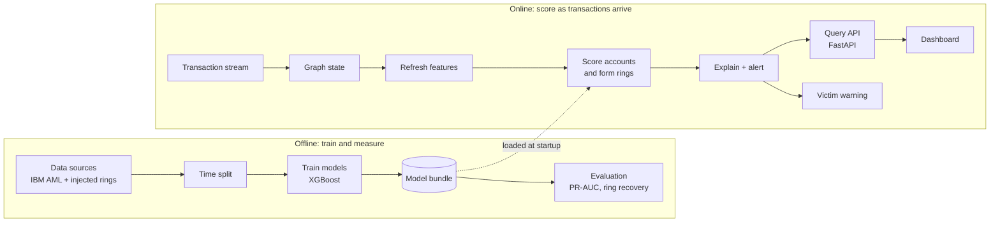

# NEXUS Z

**Graph-based fraud ring detection on IBM LinuxONE.**
IBM Z Datathon 2026. Theme: **Real-Time AI for Critical Decisions** (fraud detection).

> **Status (Oct 18, 2026):** the ML core, the scoring service, the container deployment on LinuxONE and the demo are built and measured; the dashboard is being finished. **Pig-butchering detection is only tested on synthetic rings** that our own team generated (`data/rings.py`), so there is no accuracy claim for that typology on real fraud. A model trained on IBM's labels alone finds none of those rings (0 of 10 and 0 of 20 on one draw). The demo bundle, trained with them, recovered 64 of 80 (80%) of the rings that had at least two active fraud accounts in the last 24 hours and 109 of 173 (63%) in the last 48 hours, pooled over eight random draws of the same generator (single draws 50 to 90%); those rings are 10 to 25% of the injected ones. Details and caveats: [docs/ML_RESULTS.md](docs/ML_RESULTS.md) section 7 and [eval/results/DEMO_BUNDLE.md](eval/results/DEMO_BUNDLE.md). Every number in this repository comes from a run; weak and negative results are shown too.

## The problem

Pig-butchering scams typically groom victims over weeks, then push them to deposit money on fake investment platforms. Each payment looks ordinary on its own, and the victim sends it voluntarily, so rules built around stolen credentials or unusual devices do not fire. Banks that score payments one at a time miss it.

The fraud shows up in the network and in the timing:

1. Many victims pay a few **collector** accounts.
2. Funds move through chains of **mule** accounts, often within minutes or hours.
3. Money leaves through a **cash-out** or crypto off-ramp.

People lose their savings this way. A system that flags the ring, explains why, and shows who has recently paid into it, so that they can be contacted, would help protect them.

## What NEXUS Z does

It treats the transaction network as a graph and looks for **rings** (coordinated groups) instead of single bad payments.

- Scores every recent **payment** from its own amount and channel, the money flow around it (how soon the sender received money before sending it, how soon the receiver passes it on) and both endpoints' account features: transaction, timing, graph (fan-in, PageRank, neighbors, 2-hop reach), structure (k-core, clustering), and burst and motif signals. An account's risk is its riskiest payment.
- Groups the highest-risk accounts into rings (connected by their payments, grown through weaker linked accounts, split with Louvain community detection) and gives each ring a risk score.
- Explains every flag with exact per-feature contributions (TreeSHAP, computed by XGBoost).
- Marks accounts that recently paid into a flagged ring as likely victims and lists them. Nothing is sent to anyone, and this rule has not been evaluated.

## What was measured

IBM synthetic AML data, test window (details, seeds and caveats in [docs/ML_RESULTS.md](docs/ML_RESULTS.md)):

| Result | Measured |
|---|---|
| Account-level PR-AUC (HI-Small, test window, 3 training seeds), detection of laundering inside the scored window (the features see the window's own payments, [ml/PROTOCOL.md](ml/PROTOCOL.md)) | account model 0.153; **payment-level model 0.428** (precision about 0.74, recall about 0.31); the committed model with burst and motif features is 0.453 on one seed. The 0.428 has not been re-run since the audit |
| Graph features vs transaction-only, account model only | 0.110 to 0.135 (up to 0.160 with k-core and clustering), the same on a Kaggle run and on the LinuxONE VM |
| Same comparison at 6 times the size (32M transactions) | 0.122 to 0.158 |
| Laundering groups recovered as rings (payment model, rings grown to 2%) | 34% (one seed), with 70% of rings real (account model, three seeds: 20 to 30% recovered, 31 to 46% real) |
| Groups detected in a replay of the test window in 6-hour steps | **55%** (36 of 65) with the committed model, against 20% for its account model; median 9.7 hours; 45% not detected |
| Same payment model on the lower-fraud LI-Small (one seed, Kaggle CPU) | account PR-AUC 0.093 against 0.031 for the account model, but fewer groups recovered as rings (6.8% against 10.2%) |
| Synthetic pig-butchering rings from other random draws of the generator the bundle was trained with (demo bundle, 8 draws pooled), rings with at least two active fraud accounts in the window | 80% (64 of 80) recovered in the last 24 h, 63% (109 of 173) in 48 h, given 24 to 48 hours of history; with the full history the model was trained with, 95% and 89% (75% at 48 h on a stricter definition). The IBM-only model, one draw: 0 of 10 and 0 of 20 |
| API on the VM in a hardened container | first state 12 s; a new payment visible in about 10 s on the idle VM (9.6 to 9.9 s, three probes) and up to 36 s while payments stream in; reads about 1 to 2 ms (median, loopback); no 5xx responses in one run (in that run 4,453 of 9,299 ring-detail requests returned 404 because ring ids changed on every rebuild; stable ids were added afterwards and measured once, locally) |
| Ring idea on real illicit Bitcoin wallets (Elliptic++, new addresses, 5 seeds) | illicit wallets cluster (90% of labeled neighbours illicit, 16.8x chance); our graph features lift PR-AUC from 0.348 to 0.431; rings are 85% pure but reach under 2% of illicit wallets. Not pig-butchering |
| Full rescore on the LinuxONE VM (3 vCPUs) | 0.28 s for 6 hours of data, 3.2 s for 48 hours (863K transactions), 15.7 s for all 5.1M transactions |

**What these do not show:** most laundering groups are still missed (a third recovered as rings, 45% never detected in the replay); the payment-level figures are on one dataset (HI-Small) and one time split, and the lower-fraud LI-Small was run once (precision about 9% at 33% recall); graph features added nothing on the Elliptic Bitcoin data; the injected pig-butchering rings are easy, were designed by the same side that designed the features, and the demo model was trained on rings from the same generator, so results on them are optimistic and show that the method can learn rings of this kind, not accuracy on real fraud. Aged and delayed rings are the weak spots (aged 10 of 26, delayed 13 of 35 over eight draws in the 48 hour window).

## AI-assisted chat

The dashboard has an **Assistant** page where an analyst asks questions in plain language. Every fact comes from our own API through read-only tools and every answer is checked for invented ids. There are three modes, tried in order, and the page says which one answered: (1) a **hosted open model** writes the answer (on the VM demo: NVIDIA Nemotron 3 Super 120B through NVIDIA's free NIM API, then gpt-oss-20b; it runs at NVIDIA, not on the VM, and only the question and compact synthetic ring facts leave the VM); (2) **IBM Granite Embedding** (30M parameters, free, Apache 2.0), which runs inside the API container on the LinuxONE VM, works out which question is being asked (87% right on 31 fresh questions of ours, against 35% for keyword rules, about 10 ms each) and the answer is a fixed sentence filled from the API, so nothing leaves the machine; (3) keyword rules. A hosted IBM Granite 4.2 (Hugging Face) and IBM watsonx.ai (`ibm/granite-4-h-small`) are built and unit-tested but have never answered a question (no credits, no credentials). Details, measurements and what was not tested: [docs/CHATBOT.md](docs/CHATBOT.md).

## How it uses IBM LinuxONE

- **Platform:** the datathon's LinuxONE Community Cloud VM (RHEL 9.8, s390x, 3 vCPUs, 7.5 GB RAM).
- **Training and scoring both run on the VM**, inside the platform's Jupyter Lab ML container (Podman), on CPU. Training the IBM-only payment-level bundle took about 15 minutes (882 s); the demo bundle took 31 min 46 s; see [ml/LINUXONE.md](ml/LINUXONE.md).
- **Security:** Jupyter is bound to the VM's loopback and reached through an SSH tunnel with a random token. The platform README's public port and published default token are deliberately not used.
- **Big-endian check:** an earlier account-level model trained on a little-endian laptop gave identical predictions on the s390x VM (largest difference 9e-16, 300 rows; the committed models were trained on the VM).
- **Containerized serving:** the API runs in a hardened rootless Podman container from the platform image: loopback only, non-root, read-only filesystem, every capability dropped, memory limit. `bash infra/podman_api.sh check` prints the settings read back from the running container; measured in [docs/PLATFORM_RESULTS.md](docs/PLATFORM_RESULTS.md) section 3c.
- **Accelerator, measured and not used for detection:** the VM's NNPA counters showed a TensorFlow network (5,459 operations) and IBM Granite 4.0 350M base through llama.cpp (36,106) executing some operations on the accelerator and XGBoost none (`bash infra/accel_counters.sh`; not every layer is offloaded; the raw counter output is not yet archived in the repository). A network trained on our payments was worse than the trees and Granite wrote wrong sentences, so detection is trees on the CPU and nothing a language model writes reaches a user ([docs/ML_RESULTS.md](docs/ML_RESULTS.md) section 8). We claim no accelerator speed-up.

## Architecture



The online path rebuilds features, scores and rings in micro-batches (a full recompute, not an incremental update).

### API

| Endpoint | Purpose |
|---|---|
| `POST /transactions` | Ingest a transaction or a batch |
| `GET /accounts/{id}` | Risk, role, ring, reasons, neighborhood |
| `GET /rings` | Detected rings, highest risk first |
| `GET /rings/{id}` | Members, time-ordered payments, top reasons |
| `GET /alerts` | Ring alerts and victim warnings, newest first |

The API serves invented sample data unless `NEXUSZ_BACKEND=model`; the VM deployment runs the model backend (`ml/api_backend.py`, see [ml/README.md](ml/README.md)). `POST /chat` and `GET /chat/status` serve the Assistant ([docs/CHATBOT.md](docs/CHATBOT.md)).

## Run it

```
python -m pytest ml/tests api/tests -q                 # tests
uvicorn api.main:app --port 8000                       # API with sample data
python -m ml.bundle HI-Small                           # train (needs the data, see below)
# the full demo (VM container + tunnel + dashboard + streaming replay): docs/DEMO.md
bash ml/linuxone_jupyter.sh                            # LinuxONE VM: Jupyter Lab ML container
```

The trained model and real example output are committed in [ml/artifacts/HI-Small](ml/artifacts). Heavy runs can also use a Kaggle CPU notebook: [ml/KAGGLE.md](ml/KAGGLE.md).

## Data

Public data only. All account identifiers are pseudonymized (for example `ACC-7F3A`). Datasets are not stored in this repository; set `NEXUSZ_DATA_DIR` to the folder that holds them.

| Dataset | Use | License |
|---|---|---|
| [IBM Transactions for Anti Money Laundering](https://www.kaggle.com/datasets/ealtman2019/ibm-transactions-for-anti-money-laundering-aml) (HI/LI Small, HI Medium) | Background traffic and laundering patterns | CDLA-Sharing 1.0 |
| [Elliptic Data Set](https://www.kaggle.com/datasets/ellipticco/elliptic-data-set) (Bitcoin) | Check graph features on a real labeled graph | CC BY-NC-ND 4.0 |
| [Elliptic++](https://github.com/git-disl/EllipticPlusPlus) (Bitcoin wallets; Elmougy and Liu, KDD 2023, [doi](https://doi.org/10.1145/3580305.3599803)) | One real-data check of the ring idea on illicit Bitcoin actors (not pig-butchering); evaluation only, not copied into this repository | No licence stated; citation requested |
| Injected pig-butchering rings and look-alikes (merchants, payroll, landlords, charities) | Ground truth for ring recovery and false positives | Generated by us (`data/rings.py`; the first stand-in is `ml/standin_rings.py`) |

Time-based split everywhere; features only use transactions up to the scoring time ([ml/PROTOCOL.md](ml/PROTOCOL.md)).

## Repository layout

| Path | Contents |
|---|---|
| `ml/` | Features, models, rings, explanations, scoring service, LinuxONE and Kaggle runners. [ml/README.md](ml/README.md) |
| `api/` | FastAPI service and schemas. [api/README.md](api/README.md) |
| `data/` | Dataset loaders (IBM AML, Elliptic), the pig-butchering ring generator (`rings.py`) and the demo slice exporter |
| `eval/` | Independent evaluation harness and results ([eval/results/](eval/results)) |
| `infra/` | Streaming simulator, benchmark, Podman scripts for the API and dashboard, accelerator counters |
| `dashboard/` | React dashboard (rings, alerts, Assistant) |
| `docs/` | Solution document, results ([ML_RESULTS.md](docs/ML_RESULTS.md)), team split, hand-offs, submission checklist ([SUBMISSION_CHECKLIST.md](docs/SUBMISSION_CHECKLIST.md)) |

## Open-source resources used

[XGBoost](https://github.com/dmlc/xgboost), [scikit-learn](https://scikit-learn.org), [pandas](https://pandas.pydata.org), [NumPy](https://numpy.org), [SciPy](https://scipy.org), [NetworkX](https://networkx.org) (Louvain communities), [FastAPI](https://fastapi.tiangolo.com), [Pydantic](https://docs.pydantic.dev), [Uvicorn](https://uvicorn.dev), [pytest](https://pytest.org), [Podman](https://podman.io). The Jupyter Lab ML container image and guide are from the LinuxONE Community Cloud: [linuxone-community-cloud/jupyter-lab-ml](https://github.com/linuxone-community-cloud/jupyter-lab-ml). Experiments also ran on Kaggle notebooks. Also used: [React](https://react.dev), React Router and [Vite](https://vite.dev) (MIT), [D3](https://d3js.org) (ISC), Vitest and Testing Library (MIT), [httpx](https://www.python-httpx.org) (BSD-3-Clause), [PyTorch](https://pytorch.org) (BSD-3-Clause) and [Transformers](https://github.com/huggingface/transformers) (Apache-2.0) for Granite Embedding, [TensorFlow](https://www.tensorflow.org) (Apache-2.0) and [llama.cpp](https://github.com/ggml-org/llama.cpp) (MIT) for the accelerator measurement, and the IBM Granite models ([granite-embedding-30m-english](https://huggingface.co/ibm-granite/granite-embedding-30m-english), Apache-2.0 per its model card). Hosted services, not open source: NVIDIA NIM API (Nemotron, gpt-oss), Hugging Face Inference Providers and IBM watsonx.ai (built, not used for a real answer). Software licences were read from the installed packages where possible ([docs/CLAIMS_AUDIT.md](docs/CLAIMS_AUDIT.md) section G lists what was not checked).

Datasets are cited as: Altman et al., "Realistic Synthetic Financial Transactions for Anti-Money Laundering Models", NeurIPS 2023 ([arXiv:2306.16424](https://arxiv.org/abs/2306.16424)); Weber et al., "Anti-Money Laundering in Bitcoin: Experimenting with Graph Convolutional Networks for Financial Forensics", KDD 2019 Workshop on Anomaly Detection in Finance.

## Limitations

- Accuracy is modest and most laundering groups are still missed. See the results document for the full list.
- The pig-butchering rings are synthetic and from our own generator; no claim about real fraud. Recovery depends on how much history the scorer is given (24 to 48 hours versus the full history).
- "Likely victims" are accounts that already paid into a flagged ring; the rule is not evaluated and nothing is sent.
- The Assistant's hosted answers depend on a free third-party API with no guarantee; the local mode and the rules answer if it fails.
- Scoring recomputes everything in micro-batches. It is fast on a 48-hour window, not incremental.
- Roles (victim, collector, mule, cash-out) are guessed from position inside a ring; the data has no role labels.
- Amounts mix currencies and must not be shown as dollars.
- The ring score favors small rings and was fitted on few validation rings.

## Team

| Name | Workstream |
|---|---|
| Ramana Sree K V (team lead) | Graph, features, models, rings, explanations |
| Giridharan R E | Platform, API and integration |
| Verona Ann | Data and evaluation |
| Tushar Biswas | Dashboard, victim warning and pitch |

Each member works on a branch named after them and opens a pull request into `main`. See [docs/TEAM_SPLIT.md](docs/TEAM_SPLIT.md).

## License

See [LICENSE](LICENSE).
