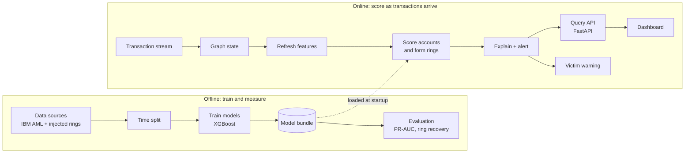

# NEXUS Z

**Graph-based fraud ring detection on IBM LinuxONE.**
IBM Z Datathon 2026. Theme: **Real-Time AI for Critical Decisions** (fraud detection).

> **Status (Oct 17, 2026):** the ML core, the scoring service and the LinuxONE training setup are built and measured. The dashboard, the real-model backend for the API and the data workstream's own ring generator are still in progress. **Pig-butchering detection is only tested on stand-in rings written by the modelling side**, so there is no accuracy claim for that typology yet. Every number in this repository comes from a run; weak results are shown too. See [docs/ML_RESULTS.md](docs/ML_RESULTS.md).

## The problem

Pig-butchering scams groom victims over weeks, then push them to deposit money on fake investment platforms. Each payment looks ordinary on its own, and the victim sends it voluntarily, so rules built around stolen credentials or unusual devices do not fire. Banks that score payments one at a time miss it.

The fraud shows up in the network and in the timing:

1. Many victims pay a few **collector** accounts.
2. Funds move through chains of **mule** accounts within minutes.
3. Money leaves through a **cash-out** or crypto off-ramp.

People lose their savings this way. A system that flags the ring early, explains why, and warns the next victim before they pay protects them.

## What NEXUS Z does

It treats the transaction network as a graph and looks for **rings** (coordinated groups) instead of single bad payments.

- Scores every recent **payment** from its own amount and channel, the money flow around it (how soon the sender received money before sending it, how soon the receiver passes it on) and both endpoints' account features: transaction, timing, graph (fan-in, PageRank, neighbors, 2-hop reach), structure (k-core, clustering), and burst and motif signals. An account's risk is its riskiest payment.
- Groups the highest-risk accounts into rings (connected by their payments, grown through weaker linked accounts, split with Louvain community detection) and gives each ring a risk score.
- Explains every flag with exact per-feature contributions (TreeSHAP, computed by XGBoost).
- Marks accounts that recently paid into a flagged ring as likely victims and raises a warning.

## What was measured

IBM synthetic AML data, test window (details, seeds and caveats in [docs/ML_RESULTS.md](docs/ML_RESULTS.md)):

| Result | Measured |
|---|---|
| Account-level PR-AUC (HI-Small, test window, 3 training seeds) | account model 0.153; **payment-level model 0.428** (precision about 0.74, recall about 0.31) |
| Graph features vs transaction-only, account model only | 0.110 to 0.135 (up to 0.160 with k-core and clustering), the same on a Kaggle run and on the LinuxONE VM |
| Same comparison at 6 times the size (32M transactions) | 0.122 to 0.158 |
| Laundering groups recovered as rings (payment model, rings grown to 2%) | 34%, with 70% of rings real (account model: 20 to 30% recovered, 31 to 46% real) |
| Groups detected in a replay of the test window in 6-hour steps | **55%** (36 of 65) with the committed model, against 20% for its account model; median 9.7 hours; 45% not detected |
| Full rescore on the LinuxONE VM (3 vCPUs) | 0.28 s for 6 hours of data, 3.2 s for 48 hours (863K transactions), 15.7 s for all 5.1M transactions |

**What these do not show:** most laundering groups are still missed (a third recovered as rings, 45% never detected in the replay); the payment-level figures are on one dataset (HI-Small) and one time split, and the lower-fraud LI-Small was only run with the account model (about 5% precision); graph features added nothing on the Elliptic Bitcoin data; the injected pig-butchering rings are easy and were designed by the same side that designed the features, so results on them are optimistic.

## How it uses IBM LinuxONE

- **Platform:** the datathon's LinuxONE Community Cloud VM (RHEL 9.8, s390x, 3 vCPUs, 7.5 GB RAM).
- **Training and scoring both run on the VM**, inside the platform's Jupyter Lab ML container (Podman), on CPU. Training the final payment-level model takes about 15 minutes; see [ml/LINUXONE.md](ml/LINUXONE.md).
- **Security:** Jupyter is bound to the VM's loopback and reached through an SSH tunnel with a random token. The platform README's public port and published default token are deliberately not used.
- **Big-endian check:** a model trained on a little-endian laptop gives identical predictions on the s390x VM (largest difference 9e-16).
- **Not used:** no on-chip AI accelerator. We make no accelerator claims.

## Architecture



The online path rebuilds features, scores and rings in micro-batches (a full recompute, not an incremental update). Team architecture reference: https://claude.ai/artifact/SHz4vHQrEPCE8Q9mQ2fLdr

### API

| Endpoint | Purpose |
|---|---|
| `POST /transactions` | Ingest a transaction or a batch |
| `GET /accounts/{id}` | Risk, role, ring, reasons, neighborhood |
| `GET /rings` | Detected rings, highest risk first |
| `GET /rings/{id}` | Members, time-ordered payments, top reasons |
| `GET /alerts` | Ring alerts and victim warnings, newest first |

The API currently serves sample data by default. `ml/api_backend.py` provides the real-model backend and is being wired in; see [ml/README.md](ml/README.md).

## Run it

```
python -m pytest ml/tests api/tests -q                 # tests
uvicorn api.main:app --port 8000                       # API with sample data
python -m ml.bundle HI-Small                           # train (needs the data, see below)
bash ml/linuxone_jupyter.sh                            # LinuxONE VM: Jupyter Lab ML container
```

The trained model and real example output are committed in [ml/artifacts/HI-Small](ml/artifacts). Heavy runs can also use a Kaggle CPU notebook: [ml/KAGGLE.md](ml/KAGGLE.md).

## Data

Public data only. All account identifiers are pseudonymized (for example `ACC-7F3A`). Datasets are not stored in this repository; set `NEXUSZ_DATA_DIR` to the folder that holds them.

| Dataset | Use | License |
|---|---|---|
| [IBM Transactions for Anti Money Laundering](https://www.kaggle.com/datasets/ealtman2019/ibm-transactions-for-anti-money-laundering-aml) (HI/LI Small, HI Medium) | Background traffic and laundering patterns | CDLA-Sharing 1.0 |
| [Elliptic Data Set](https://www.kaggle.com/datasets/ellipticco/elliptic-data-set) (Bitcoin) | Check graph features on a real labeled graph | CC BY-NC-ND 4.0 |
| Injected pig-butchering rings and look-alikes (merchants, payroll, landlords, charities) | Ground truth for ring recovery and false positives | Generated by us (stand-in in `ml/standin_rings.py`) |

Time-based split everywhere; features only use transactions up to the scoring time ([ml/PROTOCOL.md](ml/PROTOCOL.md)).

## Repository layout

| Path | Contents |
|---|---|
| `ml/` | Features, models, rings, explanations, scoring service, LinuxONE and Kaggle runners. [ml/README.md](ml/README.md) |
| `api/` | FastAPI service and schemas. [api/README.md](api/README.md) |
| `data/` | Dataset loaders (IBM AML) and profiling |
| `docs/` | Solution document, results ([ML_RESULTS.md](docs/ML_RESULTS.md)), team split, hand-offs, submission checklist ([SUBMISSION_CHECKLIST.md](docs/SUBMISSION_CHECKLIST.md)) |

## Open-source resources used

[XGBoost](https://github.com/dmlc/xgboost), [scikit-learn](https://scikit-learn.org), [pandas](https://pandas.pydata.org), [NumPy](https://numpy.org), [SciPy](https://scipy.org), [NetworkX](https://networkx.org) (Louvain communities), [FastAPI](https://fastapi.tiangolo.com), [Pydantic](https://docs.pydantic.dev), [Uvicorn](https://www.uvicorn.org), [pytest](https://pytest.org), [Podman](https://podman.io). The Jupyter Lab ML container image and guide are from the LinuxONE Community Cloud: [linuxone-community-cloud/jupyter-lab-ml](https://github.com/linuxone-community-cloud/jupyter-lab-ml). Experiments also ran on Kaggle notebooks.

Datasets are cited as: Altman et al., "Realistic Synthetic Financial Transactions for Anti-Money Laundering Models", NeurIPS 2023 ([arXiv:2306.16424](https://arxiv.org/abs/2306.16424)); Weber et al., "Anti-Money Laundering in Bitcoin: Experimenting with Graph Convolutional Networks for Financial Forensics", KDD 2019 Workshop on Anomaly Detection in Finance.

## Limitations

- Accuracy is modest and most laundering groups are still missed. See the results document for the full list.
- Scoring recomputes everything in micro-batches. It is fast on a 48-hour window, not incremental.
- Roles (victim, collector, mule, cash-out) are guessed from position inside a ring; the data has no role labels.
- Amounts mix currencies and must not be shown as dollars.
- The ring score favors small rings and was fitted on few validation rings.

## Team

| Name | Workstream |
|---|---|
| Ramana Sree K V (team lead) | Graph, features, models, rings, explanations |
| Giridharan R E | Platform, API and integration |
| Verona Ann | Data and evaluation |
| Tushar Biswas | Dashboard, victim warning and pitch |

Each member works on a branch named after them and opens a pull request into `main`. See [docs/TEAM_SPLIT.md](docs/TEAM_SPLIT.md).

## License

See [LICENSE](LICENSE).
